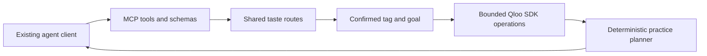

# A callable tool for existing agents

This project provides a real MCP server over standard input/output, using the public `@modelcontextprotocol/sdk`. An agent client can discover and invoke four schema-validated tools. The server makes no LLM calls and contains no model credential. The planning exercises remain deterministic templates; the cultural relationships come from Qloo.

| Tool | Operation |
| --- | --- |
| `taste_status` | Read availability without contacting Qloo. |
| `find_music_tags` | Search Qloo for one enumerated public music genre; return session-owned canonical choices. |
| `build_practice_plan` | Require a returned choice token and `userConfirmedTag=true`, recommend artists, optionally expand music tags according to the goal, then match supplied listings and build a deterministic exercise. |
| `preview_practice_plan` | Execute the explicit invented offline example with no provider call. |

The MCP bridge calls the same Express route factory as the web UI through a fixed loopback address. It retains an anonymous session cookie internally, so choices remain bound to the requesting agent session. Postgres mode shares durable sessions and canonical choices with the same implementation used by Netlify Functions. Neither tool arguments nor response text can select another provider URL. Tool schemas accept enumerated genre, goal and region values; arbitrary names, email addresses or search strings are not sent to Qloo. Both entry points use the same configured transport: either a durable five-attempt file guard with a single-process lock, or an atomic shared Postgres budget across instances. The stdio server remains a local MCP process; the hosted web API does not expose an HTTP MCP transport.

This is a tool an existing agent can use; it is not an autonomous LLM agent. Goal-dependent API orchestration is implemented in `server/tastePlanner.ts`: smooth-transition practice calls recommendations only; discovery and energy goals also expand the first two recommended artists into music tags. Provider affinity and the application's plan are labeled separately. `userConfirmedTag=true` is an explicit caller affirmation, not independent proof of human consent.

## Run from an MCP client

After `npm ci`, configure the client's command as `node`, with arguments `--import`, `tsx`, and the absolute path to `scripts/mcp-server.mjs`. Set its working directory to this checkout. Keep credentials in the ignored server `.env`; no key belongs in the client command arguments or configuration. In file-budget mode, do not launch web and MCP live processes against one counter directory simultaneously. A stale lock requires review rather than automatic deletion. Postgres mode reserves attempts atomically across both processes.

For a manual terminal launch use `npm run --silent mcp`; the silent option avoids npm banners on the JSON-RPC output stream. No client configuration or persistent authorization has been installed by preparing this source.

The offline test uses a real MCP SDK client/server pair, initializes the protocol, lists tools, calls readiness/search/plan/preview with a fixture provider, verifies rejection when confirmation is false, and checks fixture labels. SDK transport tests separately exercise the full five-call mock tag/recommendation/artist-expansion sequence. No LLM or additional real Qloo call is used for these checks. [MCP server documentation](https://modelcontextprotocol.io/docs/develop/build-server).
